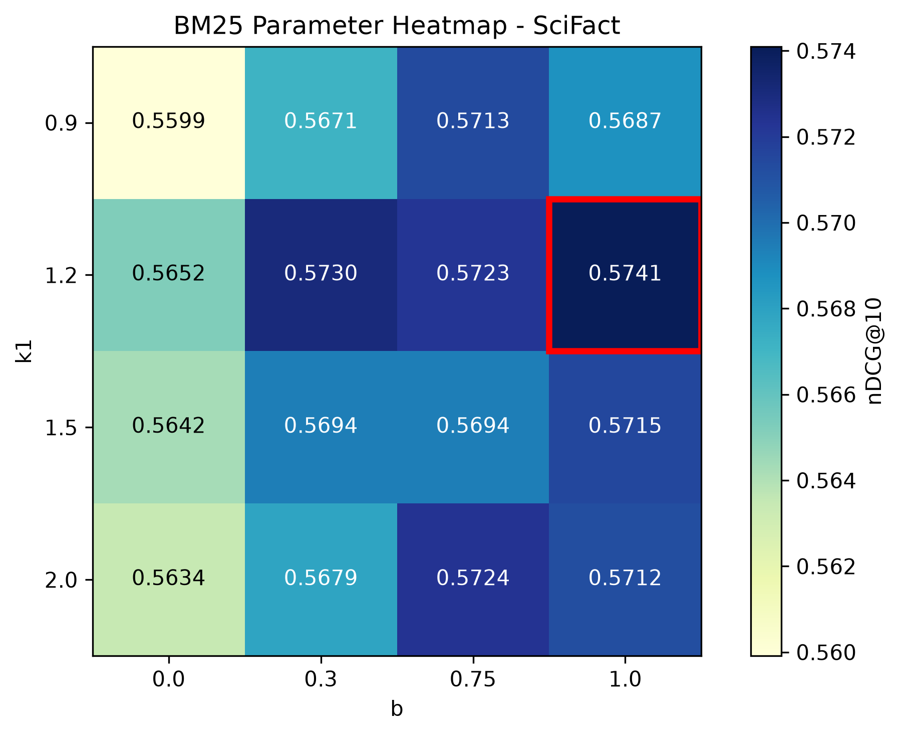
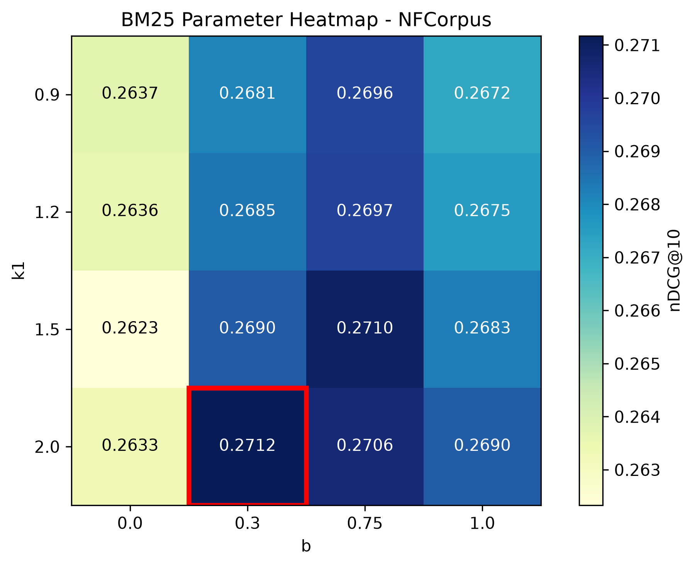

# BM25 from Scratch

Okapi BM25 and standard IR evaluation metrics implemented directly from their formulas in plain Python. No `rank_bm25`, `pyserini`, `sklearn`, or `pytrec_eval` is used in the implementation. The implementation is then validated against reference libraries on two BEIR datasets.

**Key results**

- **Ranking matches Lucene:** nDCG@10 is within **0.0004** of Pyserini/Lucene BM25 on SciFact and NFCorpus.
- **Metrics match BEIR:** all four metrics agree with BEIR / `pytrec_eval` to within **3 × 10⁻⁶**, after tracing and reproducing how `pytrec_eval` orders documents with tied scores.
- **Parameter sweep:** 16 (k1, b) combinations evaluated on both datasets, shown as heatmaps.

> This repository started as a lab exercise. Part A builds and unit-checks the implementation; Part B evaluates it on real data.

---

## What's implemented

| Module | Contents |
| --- | --- |
| [`bm25.py`](bm25.py) | `ChiMuc` (inverted index): single pass over the corpus, document lengths, term frequencies, posting lists. BM25 scoring that only touches documents in the query terms' posting lists. Deterministic top-k (score descending, then doc id). |
| [`chi_so.py`](chi_so.py) | Precision@k, Recall@k, Reciprocal Rank, Average Precision, DCG, nDCG@k with graded relevance |
| [`kho_do_choi.py`](kho_do_choi.py) | 8-document toy corpus with 3 queries and graded labels, including edge cases (a title-only document, a relevant document with zero term overlap) |
| [`kiem_tra.py`](kiem_tra.py) | 34 checks in 7 groups with expected values and a diagnostic message for each failure |
| `*_sai.py` | Intentionally faulty implementations, used to confirm that the checks actually catch common mistakes |

The scoring formula, using the "+1" IDF variant so IDF is never negative:

```
idf(t)     = ln(1 + (N − df(t) + 0.5) / (df(t) + 0.5))
score(q,d) = Σ_t∈q  idf(t) · tf(t,d) · (k1 + 1) / (tf(t,d) + k1 · (1 − b + b · |d| / avgdl))
```

Defaults: `k1 = 1.2`, `b = 0.75`.

---

## Results

All runs use the BEIR **test** split, `title + text` as the document, top-100 retrieval, and the metrics from `chi_so.py`.
SciFact has 5,183 documents and 300 queries; NFCorpus has 3,633 documents and 323 queries.

### 1. Effect of tokenization ([`phanB/b1_danh_gia_bm25.ipynb`](phanB/b1_danh_gia_bm25.ipynb))

| Dataset | Tokenizer | nDCG@10 | Recall@100 | MRR | MAP |
| --- | --- | ---: | ---: | ---: | ---: |
| SciFact | Whitespace | 0.5723 | 0.7969 | 0.5465 | 0.5379 |
| SciFact | Lucene analyzer | **0.6830** | **0.9282** | **0.6511** | **0.6403** |
| NFCorpus | Whitespace | 0.2697 | 0.2064 | 0.4828 | 0.1155 |
| NFCorpus | Lucene analyzer | **0.3219** | **0.2464** | **0.5287** | **0.1442** |

Stemming and stop-word handling in Lucene's `DefaultEnglishAnalyzer` add about 11 nDCG@10 points on SciFact. For example, "biomaterials" becomes `biomateri` and "properties." becomes `properti`.

### 2. Ranking vs. Pyserini ([`phanB/b2_so_sanh_bm25.ipynb`](phanB/b2_so_sanh_bm25.ipynb))

Both systems use the same Lucene analyzer and the same `k1 = 1.2`, `b = 0.75`. The pass criterion is |Δ| < 0.01.

| Dataset | This implementation | Pyserini | \|Δ\| |
| --- | ---: | ---: | ---: |
| SciFact | 0.6830 | 0.6826 | 0.0004 ✅ |
| NFCorpus | 0.3219 | 0.3222 | 0.0003 ✅ |

### 3. Metrics vs. BEIR, and the tie-ordering finding ([`phanB/b3_so_sanh_chi_so.ipynb`](phanB/b3_so_sanh_chi_so.ipynb))

SciFact matched immediately. NFCorpus did not: nDCG@10 differed by 7 × 10⁻⁴, in 5 queries.

The investigation found:

1. All 5 queries contained documents with **identical BM25 scores but different relevance labels**. Overall, 220 of the 323 NFCorpus queries contain ties.
2. In query `PLAIN-634`, the top two documents tie at 11.2363. Swapping them changes nDCG@10 from 0.3996 to 0.3183, which is exactly the BEIR value.
3. `pytrec_eval` re-sorts results by score and breaks ties by document id in descending order. After applying the same tie rule, every metric agrees with BEIR:

| NFCorpus | This implementation | BEIR | \|Δ\| |
| --- | ---: | ---: | ---: |
| nDCG@10 | 0.321183 | 0.321180 | 0.000003 |
| MAP@100 | 0.143887 | 0.143890 | 0.000003 |
| Recall@100 | 0.246407 | 0.246410 | 0.000003 |
| Precision@10 | 0.230650 | 0.230650 | 0.000000 |

**Takeaway:** when two evaluators disagree, check the tie-breaking rule before blaming the metric formula.

### 4. k1 / b sensitivity ([`phanB/b4_khao_sat_tham_so.ipynb`](phanB/b4_khao_sat_tham_so.ipynb))

The sweep covers k1 ∈ {0.9, 1.2, 1.5, 2.0} and b ∈ {0, 0.3, 0.75, 1.0}, scored by nDCG@10 with the whitespace tokenizer.

| | SciFact | NFCorpus |
| --- | --- | --- |
| Best | k1 = 1.2, b = 1.0 → **0.5741** | k1 = 2.0, b = 0.3 → **0.2712** |
| Default (1.2, 0.75) | 0.5723 | 0.2697 |

<p>
  
  
</p>

Turning off length normalization (b = 0) consistently hurts. Beyond that, the spread across the whole grid is small: about 0.014 on SciFact. The tokenizer choice in section 1 matters far more than parameter tuning.

---

## How to run

Requirements: Python 3.12 and [uv](https://docs.astral.sh/uv/). Section 2 also needs Java 21, which Pyserini requires.

```bash
uv sync

# Part A: check the implementation on the toy corpus (no downloads needed)
uv run python kiem_tra.py
uv run python 3_cach_ndcg.py      # correct nDCG vs. two common mistakes
```

For Part B, place the BEIR `scifact` and `nfcorpus` datasets in `phanB/du_lieu/`. The B2 notebook also reads Pyserini Lucene indexes from `phanB/du_lieu/pyserini/indexes/<dataset>`. The folder is git-ignored. Then set `JAVA_HOME` in a `.env` file at the project root and open the notebooks in order (`b1` → `b4`).

## Project structure

```
├── bm25.py               # inverted index + BM25
├── chi_so.py             # evaluation metrics
├── kho_do_choi.py        # toy corpus, queries, graded qrels
├── kiem_tra.py           # 34 checks for bm25.py and chi_so.py
├── 3_cach_ndcg.py        # correct nDCG vs. two common mistakes
├── *_sai.py              # deliberately wrong implementations
└── phanB/
    ├── b1_danh_gia_bm25.ipynb       # evaluation, two tokenizers
    ├── b2_so_sanh_bm25.ipynb        # vs. Pyserini
    ├── b3_so_sanh_chi_so.ipynb      # metrics vs. BEIR, tie analysis
    ├── b4_khao_sat_tham_so.ipynb    # k1 / b sweep
    └── ket_qua/                     # saved rankings and heatmaps
```

## References

- Robertson & Zaragoza (2009). *The Probabilistic Relevance Framework: BM25 and Beyond.*
- Thakur et al. (2021). *BEIR: A Heterogeneous Benchmark for Zero-shot Evaluation of Information Retrieval Models.*
- Lin et al. (2021). *Pyserini: A Python Toolkit for Reproducible Information Retrieval Research.*
